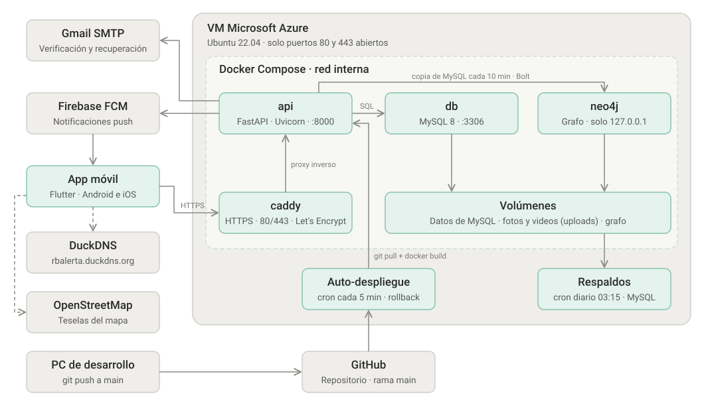

# RB Alertas

Aplicación móvil de seguridad ciudadana y alertas comunitarias para Puerto Montt.

**Versión:** Alpha 1.0.0 · **Plataformas:** Android e iOS · **API en producción:** `https://rbalerta.duckdns.org`

---

## 1. Información Académica

- **Institución:** Duoc UC, sede Puerto Montt
- **Carrera:** Ingeniería en Informática
- **Proyecto:** Capstone APT122
- **Integrantes:**
  - Bárbara Palma
  - Renato Díaz
- **Ubicación:** Puerto Montt, Chile

---

## 2. Problemática y Justificación

### Problemática

En la comuna de Puerto Montt, los vecinos enfrentan desafíos constantes en materia de seguridad ciudadana, tiempos de respuesta ante emergencias y falta de canales directos de comunicación entre las comunidades locales y los organismos pertinentes. La coordinación vecinal suele realizarse a través de plataformas no especializadas, lo que dificulta la centralización y la rápida visualización de eventos de riesgo.

### Justificación

**RB Alertas** nace como una solución tecnológica accesible y centralizada para empoderar a la comunidad. Mediante el uso de dispositivos móviles, la aplicación permite emitir alertas geolocalizadas inmediatas, acceder rápidamente a los servicios de emergencia y mantener informados a los vecinos en tiempo real, fortaleciendo la prevención y la colaboración comunitaria.

---

## 3. Objetivos del Proyecto

### Objetivo General

Desarrollar una aplicación móvil multiplataforma para la gestión de alertas de seguridad ciudadana y emergencias vecinales en la comuna de Puerto Montt, facilitando la comunicación en tiempo real y la colaboración entre vecinos.

### Objetivos Específicos

- Diseñar una interfaz de usuario intuitiva, accesible y orientada a la rápida acción en situaciones de emergencia.
- Implementar la emisión de alertas tempranas con geolocalización y el aviso a los vecinos cercanos.
- Proveer un mapa interactivo para la visualización de incidentes reportados en la zona.
- Gestionar el registro y acceso seguro de vecinos pertenecientes a la comunidad.
- Facilitar el acceso rápido a números y contactos de los principales servicios de emergencia locales.

---

## 4. Funcionalidades

### Para los vecinos

- **Cuenta y acceso:** registro con RUT y comuna, verificación por correo, inicio de sesión con sesión guardada de forma cifrada en el dispositivo y recuperación de contraseña por enlace al correo.
- **Perfil:** edición de los datos de la cuenta, foto de perfil, privacidad y seguridad, y política de privacidad.
- **Reporte de incidentes:** reporte geolocalizado con categoría, descripción y foto o video como evidencia (hasta 20 MB), público o privado para un grupo de vecinos.
- **Mapa de incidentes:** reportes vigentes con filtros por categoría y buscador de direcciones e incidentes. Los reportes del mismo hecho (misma categoría, a menos de 300 m y con menos de 3 horas de diferencia) se muestran como un solo incidente.
- **Zonas de riesgo y mapa de calor:** el mapa marca los sectores donde se repiten los hechos, con su nivel de riesgo y una recomendación, y avisa cuando el usuario se encuentra dentro de uno.
- **Validación comunitaria:** los vecinos confirman o desmienten cada reporte y conversan en sus comentarios, con respuestas y fotos.
- **Denuncias:** cualquier vecino puede denunciar un reporte o un comentario (falso, ofensivo, spam, datos personales u otro motivo) para que lo revise la administración.
- **Alertas y notificaciones push:** aviso a quien tiene una zona segura (casa, trabajo, estudio) cerca del incidente, a los miembros del grupo donde se compartió y a quien recibe un comentario o una respuesta. Quien ya recibió la alerta de un incidente no la recibe de nuevo.
- **Grupos de vecinos:** grupos con código de invitación, miembros y reportes privados del grupo.
- **Contactos de emergencia:** llamada directa a Carabineros, Bomberos, SAMU y Seguridad Ciudadana de la comuna, con confirmación previa.
- **Privacidad:** quien reporta o comenta aparece con un alias («Suricata Valiente 23»); su nombre real nunca sale de la API.

### Para la administración

El panel se abre automáticamente al iniciar sesión con una cuenta administradora y tiene siete secciones:

| Sección | Contenido |
| --- | --- |
| Resumen | Indicadores generales y red en miniatura. |
| Mapa | Mapa con los reportes de los vecinos y moderación desde la tarjeta de cada uno. |
| Reportes | Listado con filtros por estado, comentarios, cambio de estado, eliminación y suspensión del autor. |
| Denuncias | Denuncias pendientes de reportes y comentarios, para atenderlas o desestimarlas. |
| Usuarios | Cuentas registradas y su suspensión o reactivación. |
| Grupos | Grupos de vecinos, sus reportes y su estado. |
| Red (Neo4j) | Cuentas sospechosas con su evidencia, reputación de los vecinos (0 a 100) con su desglose, incidentes agrupados, ranking de zonas por cantidad de hechos y un explorador de la red con buscador, capas, línea de tiempo, comunidades y camino más corto entre dos elementos. |

---

## 5. Arquitectura y Tecnologías



La API es un monolito modular organizado en tres capas: `rutas/` (endpoints), `servicios/` (reglas de negocio) y `comun/` (utilidades compartidas). MySQL es la fuente de verdad; Neo4j es una copia analítica que se puede reconstruir desde MySQL en cualquier momento.

| Componente | Tecnologías |
| --- | --- |
| Aplicación móvil | Flutter, Dart, flutter_map (OpenStreetMap), geolocator, flutter_secure_storage, Firebase Messaging |
| API | Python 3.12, FastAPI, Uvicorn, mysql-connector-python (pool de conexiones), bcrypt |
| Datos | MySQL 8 con tipos espaciales (base principal), Neo4j (análisis en grafo) |
| Servidor | VM de Azure con Docker Compose (MySQL, API, Caddy y Neo4j), Caddy con HTTPS de Let's Encrypt, dominio `rbalerta.duckdns.org` |
| Servicios externos | Firebase Cloud Messaging, SMTP de Gmail, teselas de OpenStreetMap |
| Control de versiones y CI | Git, GitHub y GitHub Actions (compilación del `.ipa` de iPhone) |
| Pruebas | flutter_test (widgets), pytest (API), k6 (pruebas de capacidad) |

---

## 6. Estructura del Repositorio

```
CAPSTONE/
├── rb_alertas/                Aplicación Flutter.
│   ├── lib/
│   │   ├── main.dart          Punto de entrada de la app.
│   │   ├── config/            URL de la API, versión de la app y capa base del mapa.
│   │   ├── servicios/         Comunicación con la API (sesión, reportes, grupos, push, admin...).
│   │   ├── vistas/            Pantallas (mapa, alertas, perfil, grupos, panel admin y su red...).
│   │   ├── widgets/           Componentes reutilizables (comentarios, votos, denuncias, capas del mapa...).
│   │   └── tema/              Colores, tipografías y estilos de la app.
│   ├── assets/                Ícono, imágenes y fuentes (Figtree y Bricolage Grotesque, licencia OFL).
│   ├── test/                  Pruebas de widgets (con una API falsa en test/soporte/).
│   ├── android/  ios/         Proyectos de cada plataforma.
│   └── pubspec.yaml           Dependencias de la app.
├── rb_alertas_api/            API REST (ver rb_alertas_api/README.md).
│   ├── app/
│   │   ├── rutas/             Endpoints por recurso: usuarios, reportes, grupos y admin.
│   │   ├── servicios/         Reglas de negocio, correo, push y grafo Neo4j.
│   │   └── comun/             Utilidades compartidas (alias, archivos, formato, geo, SQL).
│   ├── sql/                   Scripts de cambios en la base de datos.
│   └── tests/                 Pruebas con pytest.
├── Fase 1/                    Evidencias académicas de la Fase 1 (grupales e individuales).
├── Fase 2/                    Evidencias de la Fase 2: informe final, modelo de datos, APK,
│                              y configuración del servidor (docker-compose, Caddy, scripts y respaldos).
├── docs/                      Diagramas usados en este README.
├── .github/workflows/         GitHub Actions: compilación del .ipa de iPhone.
├── PENDIENTES.md              Estado del proyecto y tareas pendientes.
└── README.md
```

---

## 7. Guía de Instalación y Ejecución

### Requisitos previos

- SDK de Flutter estable (con Dart 3.13 o superior).
- Android Studio con un emulador, o un teléfono Android con depuración USB.
- Para compilar Android: Java 17 o superior.
- Para la API: Python 3.12 o superior (ver [`rb_alertas_api/README.md`](rb_alertas_api/README.md)).

### Aplicación

1. **Clonar el repositorio:**

   ```bash
   git clone https://github.com/Nato9-7/CAPSTONE.git
   cd CAPSTONE/rb_alertas
   ```

2. **Descargar las dependencias:**

   ```bash
   flutter pub get
   ```

3. **Verificar el entorno de desarrollo:**

   ```bash
   flutter doctor
   ```

4. **Ejecutar la aplicación** en un teléfono o emulador. Por defecto usa la API de producción (`https://rbalerta.duckdns.org`):

   ```bash
   flutter run
   ```

   Para usar una API local:

   ```bash
   flutter run --dart-define=API_URL=http://10.0.2.2:3000   # emulador de Android
   ```

5. **Ejecutar las pruebas:**

   ```bash
   flutter test
   ```

> **Notificaciones push.** Requieren el archivo `android/app/google-services.json` del proyecto de Firebase, que no se sube al repositorio. Sin él, la app compila y funciona igual, pero sin notificaciones push.

### API

La instalación, configuración (`.env`) y ejecución de la API están en
[`rb_alertas_api/README.md`](rb_alertas_api/README.md).

---

## 8. Generación de los Instaladores

### Android (APK)

Desde `rb_alertas/`:

```bash
flutter build apk --split-per-abi
```

Genera un APK por arquitectura en `build/app/outputs/flutter-apk/`. El que se distribuye es `app-arm64-v8a-release.apk`, compatible con la mayoría de los teléfonos actuales.

### iPhone (IPA)

El `.ipa` se compila en GitHub Actions, ya que requiere macOS:

1. En GitHub, abrir **Actions → Build iOS (.ipa sin firmar) → Run workflow**.
2. Al terminar, descargar el artefacto `rb_alertas-ipa`.

El `.ipa` se genera **sin firmar**; para instalarlo en un iPhone debe firmarse con una cuenta de Apple.

---

## 9. Pruebas y Calidad

| Ámbito | Herramienta | Cobertura |
| --- | --- | --- |
| Aplicación | `flutter test` | Pantallas en distintos tamaños, mapa con zonas de riesgo, red del panel y teclado en los comentarios. |
| API | `pytest tests` | Agrupación de incidentes, zonas de riesgo y mapa de calor, cuentas sospechosas y reputación, alias, archivos subidos y traducción de errores de MySQL. |
| Capacidad | k6 sobre el servidor | Requisitos no funcionales de rendimiento y escalabilidad (resultados abajo). |

Resultados de las pruebas de capacidad (Informe de Pruebas de Capacidad v1.2, 08-11-2026):

| Requisito | Meta | Resultado | Estado |
| --- | --- | --- | --- |
| RNF-01 · Calcular a quién avisar de un reporte | < 5 s con 1.000 usuarios | 195 ms con 10.000 usuarios | Cumple |
| RNF-02 · Consultas del mapa | < 500 ms con 5.000 reportes | 11,7 ms y 29,9 ms con 5.021 reportes | Cumple |
| RNF-03 · Reportes simultáneos | 50 sin errores | 50 de 50 exitosos; percentil 95 de 1.160 ms | Cumple con observación |

La prueba de RNF-03 detectó que el pool de conexiones a MySQL se agotaba bajo concurrencia; se corrigió (de 5 a 32 conexiones) y la tasa de error pasó del 80 % al 0 %.

---

## 10. Forma de Trabajo y Despliegue

- Una rama por tarea (`feature/<nombre>`), commits en español; se fusiona a `dev` y luego a `main`.
- **Subir a `main` publica la API en producción:** el servidor revisa los cambios cada 5 minutos y, si cambió algo dentro de `rb_alertas_api/`, reconstruye la API con Docker. Si la versión nueva no responde, vuelve sola a la anterior.
- En el servidor corren con Docker Compose MySQL, la API, Caddy (HTTPS) y Neo4j. La app solo se comunica con Caddy por HTTPS; MySQL y Neo4j se administran desde el computador mediante un túnel SSH.
- La base de datos se respalda diariamente.
- El estado actual del proyecto y lo que falta está en [`PENDIENTES.md`](PENDIENTES.md).

---

## 11. Documentación del Proyecto

Además de este repositorio, el proyecto cuenta con la siguiente documentación técnica, entregada por separado:

| Documento | Contenido |
| --- | --- |
| Diseño de Arquitectura del Sistema (v2.0, 08-11-2026) | Drivers, decisiones de arquitectura, vistas de módulos, datos, despliegue y procesos, seguridad y riesgos. |
| Informe de Pruebas de Capacidad (v1.2, 08-11-2026) | Diseño, ejecución y resultados de RNF-01 a RNF-03, con sus hallazgos. |
| Documentación del stack Docker | Operación del servidor, respaldos y migración a Azure. |
| Habilitación de HTTPS con DuckDNS y Caddy | Procedimiento para publicar la API con certificado TLS. |
| Script de la Base de Datos | Creación del esquema MySQL. |
| Diagramas UML (PlantUML) | Casos de uso, actividades, secuencias, estados, navegación, arquitectura, despliegue y modelo de datos. |
| Diseño de la app | Prototipo visual de las pantallas. |
